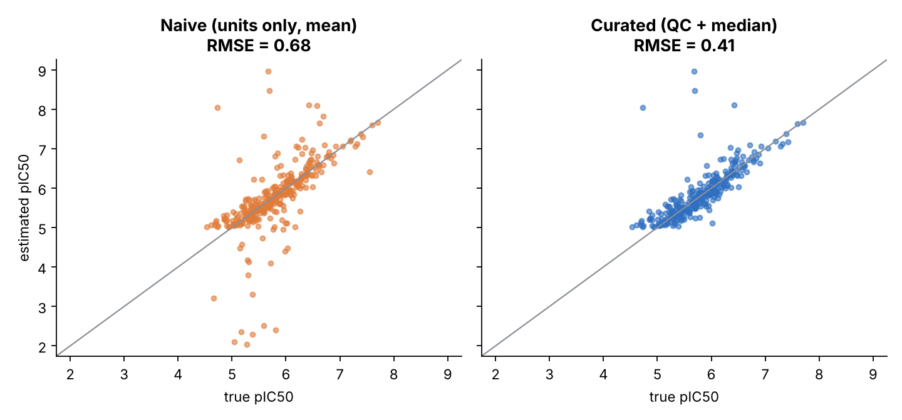

# Project 1 - Bioactivity Data QC and Curation

A reproducible pipeline that audits a ChEMBL-style IC50 export, flags unreliable records, and aggregates the rest into
one defensible potency value per compound. Bad bioactivity data silently ruins downstream SAR analysis and model
training; this project shows how to find and quantify the problems.

## The problem

Raw activity tables mix units (nM, uM, M and many spellings), contain duplicates, wrong endpoints (Ki or EC50 in an IC50
column), impossible values, broken or conflicting structures, and replicate measurements that disagree by orders
of magnitude. Averaging them naively gives wrong potencies.

## Approach

`src/bioqc/checks.py` adds a boolean `flag_*` column per problem and never drops rows, so there is a full audit trail:

| Check | Catches |
|---|---|
| missing / non-positive value | blank, zero, negative results |
| unit normalisation | spelling variants (nM, nm, uM, micro sign...), unknown units |
| endpoint check | Ki / EC50 mixed into an IC50 table |
| structure validity | unbalanced SMILES and structures outside the series |
| exact duplicates | repeated records |
| structure conflict | same compound ID with a different structure |
| assay range | exact results outside the assay's dynamic range (typically a unit slip) |
| replicate statistics | >= 3 replicates: robust z-score (median/MAD); labels 1000-fold shifts as probable unit errors; 2 replicates: discordant-pair flag |

`src/bioqc/clean.py` excludes every flagged record, keeps censored (`>`) results separately, aggregates the median
pIC50 per compound, and assigns a confidence level (high / medium / censored_only).

## Results (synthetic data, seed 7; 903 raw records for 400 compounds, 139 injected problems of 9 types)

Because the injection log is the answer key, detection is measured:

| Injected problem | Injected | Excluded | Recall |
|---|---:|---:|---:|
| exact duplicate | 18 | 18 | 100% |
| invalid SMILES | 18 | 18 | 100% |
| missing value | 9 | 9 | 100% |
| negative value | 9 | 9 | 100% |
| zero value | 4 | 4 | 100% |
| wrong endpoint | 27 | 27 | 100% |
| unit mislabel (nM vs uM) | 27 | 24 | 89% |
| structure/ID conflict | 9 | 8 | 89% |
| outlier replicate | 18 | 14 | 78% |

Overall recall **94.2%**; precision of exclusions **87.9%**.

Effect on the quantity that matters, potency accuracy against the hidden true pIC50:

| Pipeline | Compounds | RMSE | MAE | Share of compounds with error > 1 log unit |
|---|---:|---:|---:|---:|
| Naive (units only, mean) | 316 | 0.680 | 0.344 | 8.5% |
| **Curated (QC + median)** | 291 | **0.410** | **0.205** | **1.7%** |



## Honest limitations

- **Single-replicate compounds cannot be cross-checked.** Only 5 curated compounds still have an error above 1 log
  unit, and 4 of the 5 rest on a single record (132 of 291 curated compounds are single-record). This is a property of
  the data, not something a smarter threshold can fix.
- **Precision is below 100% by design.** 18 of the 149 excluded records were actually fine: 9 from discordant replicate
  pairs (two replicates that disagree cannot be attributed to one record, so both are dropped), 6 from the outlier
  rule and 3 from tied structure conflicts. This is a configurable trade-off between losing good data and keeping bad data.
- Curation also reduces coverage (291 vs 316 compounds with a potency), because some compounds lose all usable records.
- The SMILES check is specific to this series; for arbitrary chemistry use RDKit sanitisation.

## Run it

```bash
python run_pipeline.py                    # synthetic data -> results/qc_report.md, figures, tables
python run_pipeline.py --input my.csv     # curate your own export (columns: record_id, compound_id, smiles,
                                          #   standard_type, standard_relation, standard_value, standard_units, ...)
python -m pytest tests                    # 25 tests, including end-to-end checks against the injection log
```

Outputs: `results/qc_report.md`, `record_level_flags.csv`, `curated_compounds.csv`, `detection_performance.csv`,
`accuracy_vs_truth.csv`, and three figures. `data/injection_log_ANSWER_KEY.csv` is used only for evaluation.
