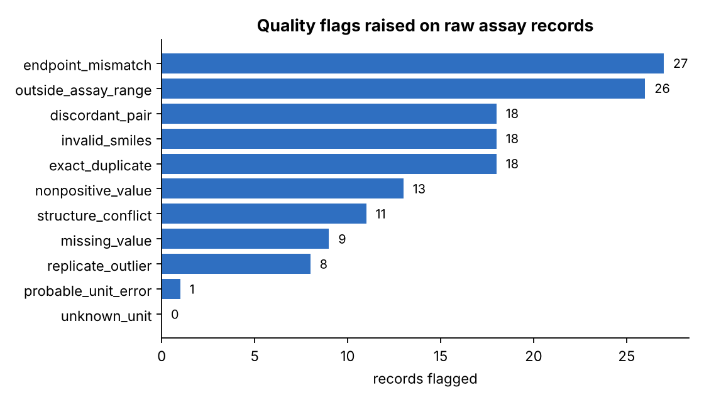
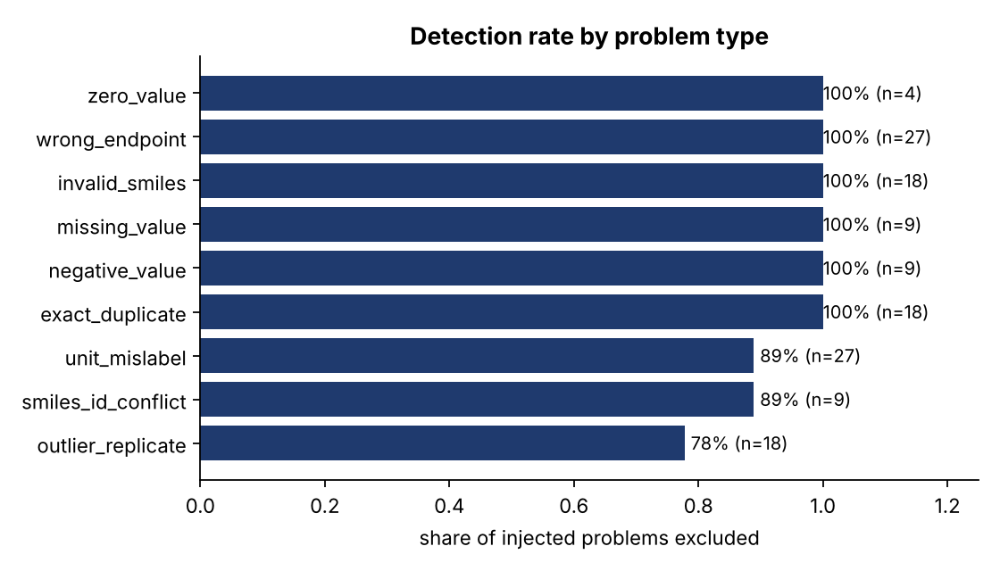
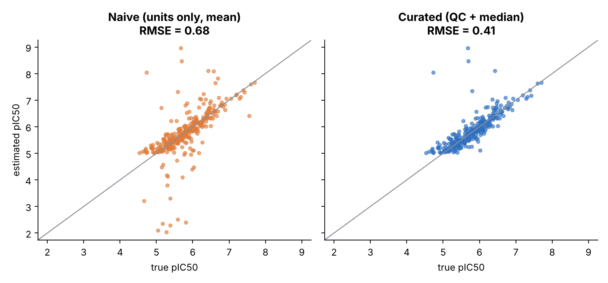

# Bioactivity data QC report

Synthetic ChEMBL-style IC50 export, random seed 7. Ground truth is known, so detection and accuracy are measured, not assumed.

## 1. Dataset

- Raw records: **903** for **400** compounds
- Records excluded by QC: **149**
- Records kept as censored (`>` relation, retained separately): **211**

## 2. Flags raised

| Flag | Records |
|---|---:|
| missing_value | 9 |
| nonpositive_value | 13 |
| unknown_unit | 0 |
| endpoint_mismatch | 27 |
| invalid_smiles | 18 |
| exact_duplicate | 18 |
| structure_conflict | 11 |
| outside_assay_range | 26 |
| probable_unit_error | 1 |
| replicate_outlier | 8 |
| discordant_pair | 18 |

## 3. Detection performance against the injection log

| Problem type | Injected | Excluded | Recall |
|---|---:|---:|---:|
| exact_duplicate | 18 | 18 | 100.0% |
| invalid_smiles | 18 | 18 | 100.0% |
| missing_value | 9 | 9 | 100.0% |
| negative_value | 9 | 9 | 100.0% |
| outlier_replicate | 18 | 14 | 77.8% |
| smiles_id_conflict | 9 | 8 | 88.9% |
| unit_mislabel | 27 | 24 | 88.9% |
| wrong_endpoint | 27 | 27 | 100.0% |
| zero_value | 4 | 4 | 100.0% |

Overall recall **94.2%**, precision of exclusions **87.9%** (18 clean records excluded out of 149).

### Known limitations (by design of the data, not hidden)

- **Single-replicate compounds** cannot be checked for outliers or mislabelled units; these are the main source of missed `unit_mislabel` and `outlier_replicate` records.
- **Structure/ID conflicts** can only be detected when a compound has other records to compare with. When two structures are tied, both records are excluded (some clean records are lost).
- **Two-replicate disagreements** cannot be attributed to either record, so a discordant pair excludes both. This, the tied-structure rule and the robust-outlier rule are why precision is below 100%: some genuine records are excluded to avoid keeping a wrong one. The thresholds are configurable trade-offs.
- The SMILES check is specific to this chemical series. For arbitrary structures use RDKit sanitisation.

## 4. Effect of curation on potency accuracy

| Pipeline | Compounds | RMSE (pIC50) | MAE | Max abs error | Share with error > 1 |
|---|---:|---:|---:|---:|---:|
| curated (QC + median) | 291 | 0.410 | 0.205 | 3.33 | 1.7% |
| naive (units only, mean) | 316 | 0.680 | 0.344 | 3.40 | 8.5% |

## 5. Curated dataset confidence

| Confidence | Compounds |
|---|---:|
| high | 154 |
| medium | 137 |
| censored_only | 86 |

`high` = at least 2 clean replicates with SD <= 0.5 log units; `medium` = 1 clean replicate or larger spread; `censored_only` = only `>` results (weaker than the assay ceiling).
