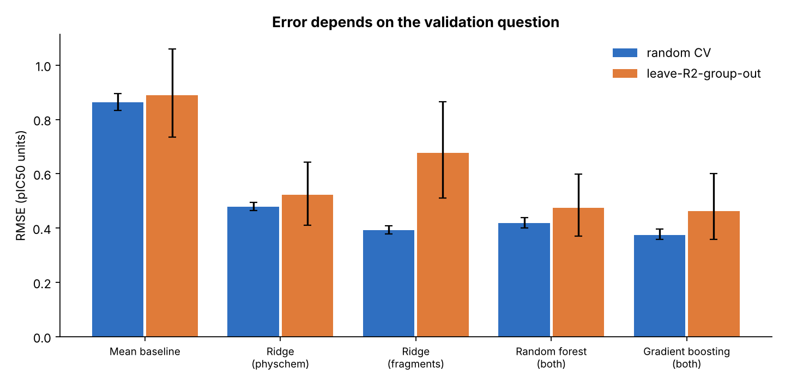
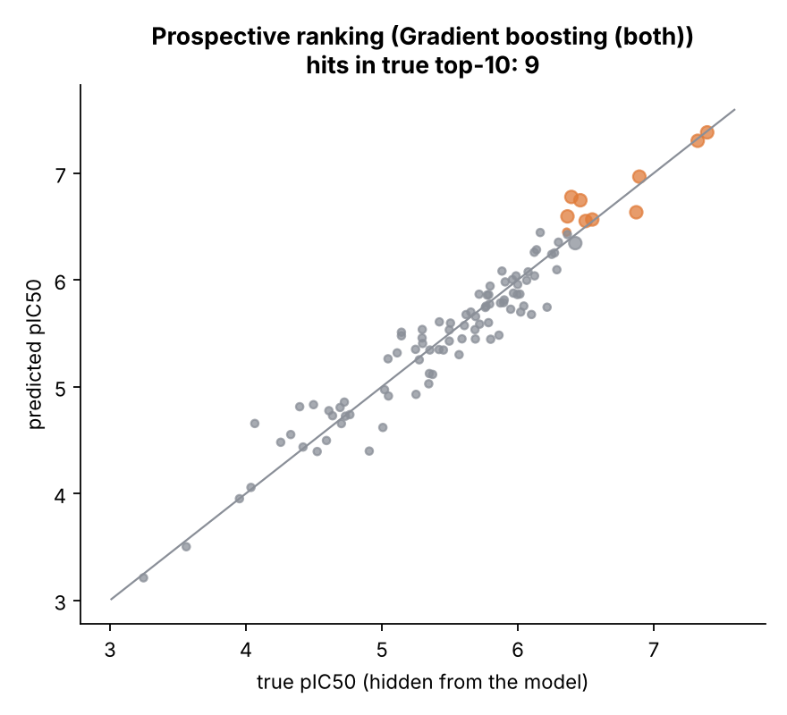
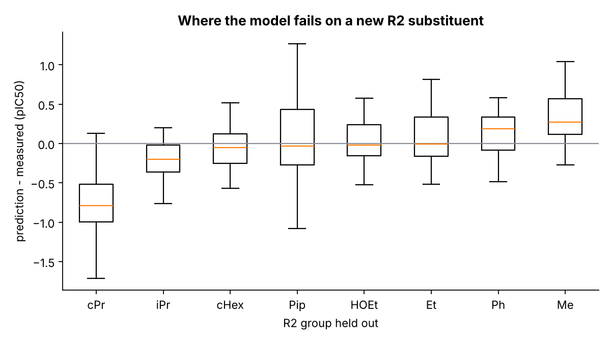

# Project 2 - SAR Modelling with Honest Validation

Builds and *stress-tests* structure-activity models on a 400-compound benzamide library with a known ground-truth SAR
(three substituent positions R1, R2, R3, a quadratic lipophilicity optimum, one planted pocket-fit synergy and one planted
steric-clash "activity cliff"). 300 compounds are "measured" with noise (SD 0.3 pIC50); 100 are held back as a virtual
set whose true activity the models never see.

The point is not a high score. It is showing **how much a score depends on the validation question**, whether the model has
learned real SAR, and where it should not be trusted.

## 1. Two validation questions, two answers

* **Random 5-fold CV (5 repeats):** "predict compounds from the same chemical space as training" (interpolation).
* **Leave-one-R2-group-out:** "predict a compound with an amide substituent the model has never seen" (extrapolation to new
  chemistry, the situation that matters when a project moves on).

| Model | RMSE, random CV | RMSE, leave-R2-group-out | R2, group-out |
|---|---:|---:|---:|
| Mean baseline | 0.863 | 0.889 | -0.81 |
| Ridge (physchem descriptors) | 0.479 | 0.522 | 0.36 |
| Ridge (fragment one-hot) | 0.392 | **0.676** | **-0.11** |
| Random forest (both) | 0.419 | 0.474 | 0.48 |
| Gradient boosting (both) | **0.375** | 0.463 | 0.50 |

95% bootstrap intervals over folds are in `results/model_comparison.csv` (they are wide for the group scheme: only 8 folds).



**Reading it:** the fragment-based linear model looks excellent under random CV (R2 0.79) but is worse than predicting the
mean when it meets a new R2 substituent (R2 -0.11), because it has no information about a group it never saw. Models that
see physicochemical descriptors (lipophilicity, size, polarity) transfer better. Reporting only random CV would have hidden this.

## 2. Did the models learn real SAR?

* **Matched molecular pairs.** For every substituent, pairs of measured compounds that differ only at that position give an
  average potency change. These estimates track the hidden truth almost perfectly: **r = 0.991 across 20 substituents,
  mean absolute error 0.06 pIC50** (largest miss 0.19). See `matched_pair_recovery.png`.
* **Feature importance** (permutation, gradient boosting): lipophilicity dominates (drop in R2 0.39), followed by the
  cyclopropyl amide (0.15). Both correspond to planted effects (the logP optimum and the pocket-fit substituent).
* **Prospective ranking on the 100 hidden compounds:** RMSE 0.20, Spearman 0.96, and **9 of the true top-10 compounds
  were in the model's top-10** (1 expected by chance, enrichment 9x).



## 3. Where it fails



* **Interaction effects.** An additive model cannot represent the planted R2 = piperidinyl + R3 = Cl steric clash. Testing
  every substituent pair for systematic residuals puts it **first** (mean residual -0.78 against a true penalty of -1.0,
  p = 0.0005), but after Benjamini-Hochberg correction for the 139 substituent pairs examined it has **q = 0.073, which does not
  reach 0.05**. With only 8 compounds carrying that pair, this is a plausible lead worth a confirmatory experiment, not
  a proven finding (`interaction_residuals.csv`). Other top pairs have q = 0.15-0.18 and are consistent with noise.
* **"Activity cliffs" from single noisy measurements are mostly not cliffs.** 53 R3-swap pairs differ by >= 1 log unit,
  but only 4 involve the planted clash. Most are ordinary Cl-to-OMe changes (true effect about -0.7) pushed past the
  threshold by measurement noise (a pair difference has SD about 0.42). Cliff calling needs replicates.
* **The applicability-domain check was not informative here.** Error by distance to the nearest training compound in
  physicochemical space was non-monotonic (near RMSE 0.35, mid 0.62, far 0.46). Descriptor-space distance does not capture
  the substituent-identity effects that drive error in this library, so it should not be used as a trust signal on this
  evidence. A fragment-aware distance would be the next thing to try.

## Honest limitations

* Synthetic series: 400 compounds, 3 positions. Real projects have more chemistry and noisier, sparser data.
* Descriptors are additive approximations (see `common/medchem_common/fragments.py`); in a real project use RDKit
  descriptors and fingerprints.
* The group-out scheme has only 8 folds, so its intervals are wide; differences between the top three models are not significant.
* The best model is selected using the same group-out scores that are reported, a mild optimistic bias; the hidden virtual
  set is the unbiased check (reported above).

## Run it

```bash
python run_analysis.py          # ~20 s; writes results/ (tables + 8 figures)
python -m pytest tests          # 14 tests: split leakage, feature alignment, metrics, BH correction, MMP recovery
```
