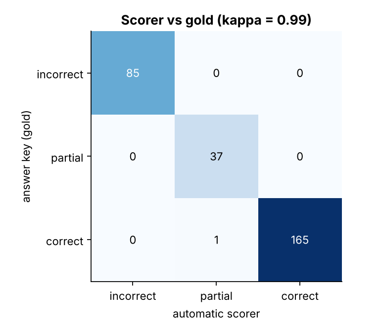
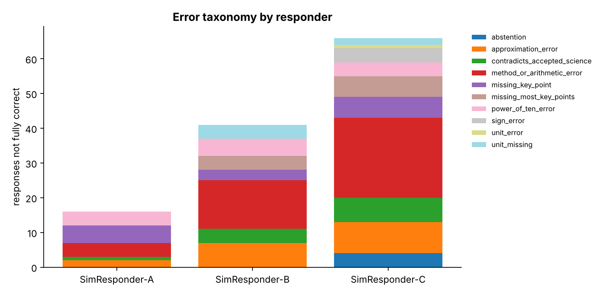

# Project 3 - Scientific-Answer Evaluation Harness

A harness for grading free-text answers to medicinal-chemistry, pharmacology and omics-statistics questions: the core of
assessing AI-generated output for scientific accuracy and writing actionable feedback for model improvement.

## What is in it

* **24-question benchmark** (`data/benchmark.json`): 18 calculations and 6 concept questions across potency and assay
  math (pIC50, IC50, replicate averaging), enzyme kinetics (Cheng-Prusoff, binding free energy, occupancy), assay quality
  (Z'), drug-likeness (ligand efficiency, LLE, Lipinski), omics statistics (log2 fold change, Benjamini-Hochberg,
  Bonferroni, hypergeometric enrichment), assay preparation (C1V1), pharmacology (Hill inhibition, selectivity), and
  concepts (Ki vs IC50, random vs scaffold splits, rule of five, mixed units, PAINS, multiple testing).
* **Computed answer keys.** Every numeric answer comes from a small tested function in `src/sciqa_eval/reference.py`, never typed
  by hand. Each question lists the *plausible wrong answers* a person might give (wrong formula, forgotten conversion).
* **Scorer** (`src/sciqa_eval/scorer.py`): extracts the numeric answer (prefers an explicit "Final answer:"), converts
  units (nM/uM/M, uL/mL, kcal/kJ), applies a per-question tolerance, and classifies the error:
  `power_of_ten_error`, `unit_error`, `unit_missing`, `sign_error`, `approximation_error`,
  `method_or_arithmetic_error`, `abstention`. Concept answers are scored by rubric-group coverage, with detection of
  scientifically wrong claims and a negation guard so "it is a myth that X" is not penalised as "X".
* **Per-responder feedback** (`results/feedback/*.md`): prioritised issues, affected questions and a concrete training
  recommendation for each error type.

## Validating the grader (the part most evaluation projects skip)

An automatic grader is only useful if you know how often it is wrong. Three simulated responders with different error mixes
produce 288 responses (3 x 24 questions x 4 samples) whose correct label is known by construction. The scorer is then
measured against that key:

| | Value |
|---|---|
| Exact agreement with the answer key | **99.7%** (287 / 288) |
| Cohen's kappa / linearly weighted kappa | **0.994** / 0.996 |
| Responses wrongly given credit as `correct` | 0 |

|  | scorer: incorrect | scorer: partial | scorer: correct |
|---|---:|---:|---:|
| **gold: incorrect** | 85 | 0 | 0 |
| **gold: partial** | 0 | 37 | 0 |
| **gold: correct** | 0 | 1 | 165 |



**How the validation changed the grader.** The first version agreed on only 93.4%. Thirteen correct answers were marked wrong
because answers written as "7.6 is what I get from ... with IC50 = 25 nM" had their *last* number (a restated input) extracted.
Fixing the extraction order (explicit final answer, then "the answer is", then a leading number) raised agreement to 99.0%. The
last two disagreements exposed a benchmark-design flaw rather than a scorer bug: a molecular-weight answer 4% off (hydrogens forgotten)
earned partial credit under the generic 10% band, so exact-arithmetic questions now allow no partial credit (99.7%).
All three fixes were made after inspecting errors on this same set, so the figure is partly in-sample; the real test is
how the grader performs on your own, unconstrained responses (see below).

**Remaining error (1):** a correct concept answer that expresses one of its required points in wording containing none of the
expected keywords is under-scored as `partial`. This is the known limit of keyword rubrics; the report recommends routing concept
answers scored `partial` to human or model-assisted review.

## Example results (simulated responders, not real models)

| Responder | Mean score (95% CI) | Strict accuracy |
|---|---|---:|
| SimResponder-A | 0.881 (0.818-0.934) | 83.3% |
| SimResponder-B | 0.677 (0.593-0.761) | 57.3% |
| SimResponder-C | 0.440 (0.353-0.530) | 31.2% |

The three responders are deterministic simulators with known error profiles, so these numbers demonstrate that the harness
separates weak from strong responders and attributes their errors; they say nothing about any real language model. Per-category
cells average only 4-16 responses, so use the overall means for comparisons.



## Grade your own responses

```bash
python evaluate_responses.py --responses my_responses.jsonl --outdir my_results
```

Input is JSONL, one object per line:

```json
{"response_id": "gpt-N01-1", "responder": "my-model", "question_id": "N01", "text": "IC50 = 25 nM, so pIC50 = 7.6. Final answer: 7.6"}
```

Question ids are listed in `data/benchmark.json`. Asking the model to end with a `Final answer:` line makes numeric extraction
reliable. The output is `evaluation_report.md`, `scored_responses.csv`, figures and a feedback file per responder.

## Run it

```bash
python run_evaluation.py        # builds benchmark, simulates responders, scores, validates, reports
python -m pytest tests          # 25 tests: reference values by hand, extraction, tolerance edges, error taxonomy,
                                #           negation guard, scorer-vs-key agreement
```

## Limitations

* The benchmark is small (24 questions) and written for demonstration; a production benchmark needs expert review of every
  item and many more questions per topic.
* Keyword rubrics are brittle to paraphrase and cannot judge reasoning quality; they are a triage tool.
* Simulated responders are not language models, and the simulator was written by the same author as the scorer, so the
  agreement figure is optimistic compared with grading real, unconstrained model output.
