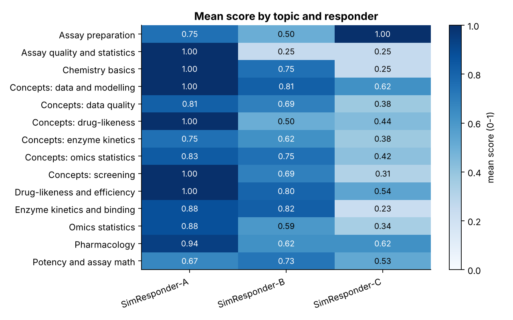
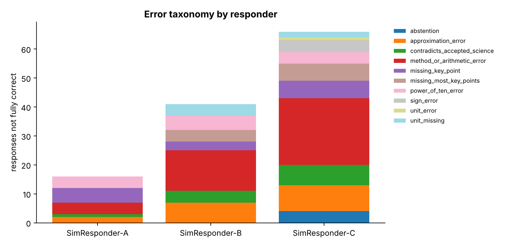
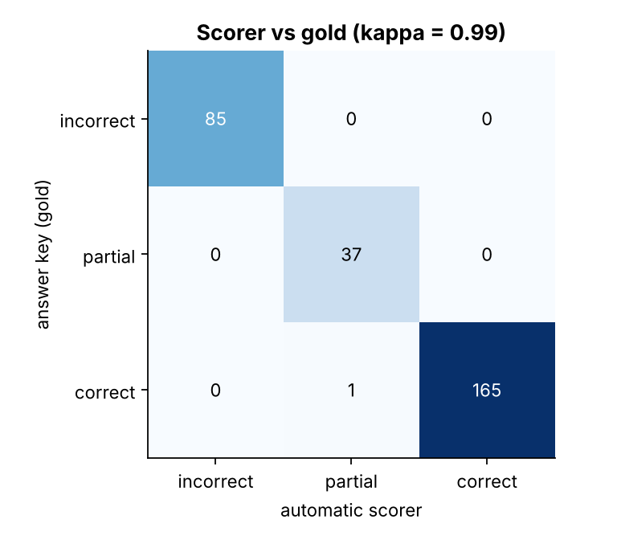

# Scientific-answer evaluation report

Benchmark: **24 questions** (18 calculations with computed answer keys, 6 concept questions with rubrics). **288 responses** from 3 simulated responders (seed 2026).

> The responders are controlled simulators with known error mixes, not real language models. They exist so the automatic scorer can be validated against an answer key. Real model outputs can be graded with `evaluate_responses.py`.

## 1. Results by responder

| responder      |   responses |   mean_score |   ci95_low |   ci95_high |   strict_accuracy |   partial_share |   incorrect_share |
|:---------------|------------:|-------------:|-----------:|------------:|------------------:|----------------:|------------------:|
| SimResponder-A |          96 |        0.881 |      0.818 |       0.934 |             0.833 |           0.073 |             0.094 |
| SimResponder-B |          96 |        0.677 |      0.593 |       0.761 |             0.573 |           0.146 |             0.281 |
| SimResponder-C |          96 |        0.440 |      0.353 |       0.530 |             0.312 |           0.177 |             0.510 |

Mean score: correct = 1, partial = 0.5-0.8, incorrect = 0. CI is a bootstrap over responses.

Each heatmap cell averages only 4-16 responses, so differences between individual cells are indicative, not statistically established; use the overall means and their intervals for comparisons.

## 2. Error taxonomy

| error_type                   |   SimResponder-A |   SimResponder-B |   SimResponder-C |
|:-----------------------------|-----------------:|-----------------:|-----------------:|
| abstention                   |                0 |                0 |                4 |
| approximation_error          |                2 |                7 |                9 |
| contradicts_accepted_science |                1 |                4 |                7 |
| method_or_arithmetic_error   |                4 |               14 |               23 |
| missing_key_point            |                5 |                3 |                6 |
| missing_most_key_points      |                0 |                4 |                6 |
| power_of_ten_error           |                4 |                5 |                4 |
| sign_error                   |                0 |                0 |                4 |
| unit_error                   |                0 |                0 |                1 |
| unit_missing                 |                0 |                4 |                2 |

## 3. Validating the automatic scorer against the answer key

- Exact agreement with gold labels: **99.7%** (287 of 288)
- Cohen's kappa: **0.994**; linearly weighted kappa: **0.996**

| kind    |   responses |   agreement |
|:--------|------------:|------------:|
| concept |      72.000 |       0.986 |
| numeric |     216.000 |       1.000 |

### Where the scorer disagrees with the key

| simulated_behaviour   | gold_label   | scorer_label   |   count |
|:----------------------|:-------------|:---------------|--------:|
| correct               | correct      | partial        |       1 |

Examples:

- `SimResponder-A-C06-1` (gold **correct**, scorer **partial**): Short answer: Many apparently significant genes would simply be noise. Testing thousands of genes at once is a multiple testing problem. Control the false discovery rate with the Benjamini-Hochberg procedure.

### Reading the disagreements

- *Paraphrase misses*: a correct concept answer worded without any rubric keyword is under-scored by the keyword rubric (gold correct, scorer partial). This is the main limitation of keyword rubrics.
- *Extraction misses*: when the answer is not marked and is followed by restated inputs, last-number extraction can pick the wrong value. Requiring a `Final answer:` line removes this failure mode.

Recommended workflow: use the automatic scorer for fast triage, and route concept answers scored `partial` to human (or model-assisted) review.
